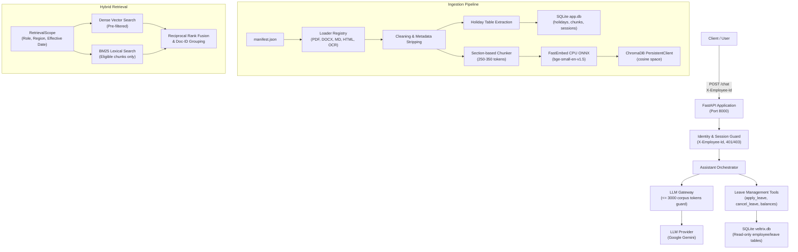

# Veltrix PeopleOps Assistant

Production-grade HR Q&A and Leave Management HTTP Service built with FastAPI, embedded ChromaDB, and FastEmbed.

---

## Architecture Overview



---

## Setup and Quickstart

### Prerequisites
- Python 3.12+
- `uv` package manager (`pip install uv` or via official installer)
- Tesseract OCR (installed and available in system PATH)

### 1. Installation
Clone the repository and install all dependencies:
```bash
uv sync
```

### 2. Environment Configuration
Create a `.env` file from the provided template:
```bash
cp .env.example .env
```

> **LLM Provider Note**: The current implementation supports **only the Google Gemini client** (`LLM_PROVIDER=gemini`). Provide your Gemini API key via `GEMINI_API_KEY` or `GOOGLE_API_KEY` in `.env`. Alternative providers are not supported in this release.

Ensure the data paths in `.env` point to your `./data` directory:
```env
CORPUS_DIR=./data/corpus
MANIFEST_PATH=./data/manifest.json
DB_PATH=./data/veltrix.db
APP_DB_PATH=./app.db
CHROMA_DIR=./chroma_db
APP_TODAY=2026-09-15
LLM_PROVIDER=gemini
GEMINI_API_KEY=your_gemini_api_key_here
```

### 3. Running with Docker Compose
The complete application with background ingestion and health checks can be started using Docker Compose:
```bash
docker compose up --build
```
The service will start listening on port 8000 immediately:
- `GET /health` returns HTTP 503 while ingestion is running in the background.
- `GET /health` returns HTTP 200 `{"status": "ok"}` once all documents and calendars are fully indexed.

### 4. Running Locally
To run the service locally:
```bash
uv run uvicorn veltrix.api.main:app --host 0.0.0.0 --port 8000
```

### 5. Running the Streamlit Web Front-End
Launch the professional Streamlit UI:
```bash
make ui
# Or directly:
uv run streamlit run src/veltrix/ui/app.py --server.port 8501
```
Open your browser at `http://localhost:8501`. You will have an input box in the sidebar to enter any Employee ID (e.g. `E1001` for HR, `E2001` for Manager, `E3001` for Employee), which is sent to the `/chat` endpoint using the `Authorization: Bearer <ID>` header.

### 6. Running the Automated Test Suite
Run the test suite via `make` or `uv`:
```bash
make test
# Or directly:
uv run pytest
```
Run linting:
```bash
make lint
```

---

## Document Ingestion Features
- **Universal Format Support**: Handled via `LoaderRegistry` for `.pdf`, `.docx`, `.md`, and `.html`.
- **Scanned Document OCR**: Seamless 300 DPI image rendering, Pillow contrast enhancement, and Tesseract OCR execution for scanned PDFs with no text layer.
- **Table Preservation**: Tables in DOCX, Markdown, and HTML are preserved in chronological context; large tables are segmented by row groups while repeating headers.
- **Holiday Extraction**: Automatic parsing of holiday tables from calendar documents into SQLite `holidays` table with flexible date normalization.
- **Idempotency**: Computes a SHA-256 hash over `manifest.json` and all corpus files. If the hash matches the previous run, re-indexing is skipped.

## Tested Sample Queries and Evaluation

You can execute sample queries against the live API using the bundled evaluation script:
```bash
uv run python scripts/eval_queries.py --base-url http://localhost:8000
```

### Representative Test Cases
1. **Policy RAG Query (India Medical Leave)**:
   ```bash
   curl -X POST http://localhost:8000/chat \
     -H "Content-Type: application/json" \
     -H "X-Employee-Id: EMP-001" \
     -d '{"session_id": "test-s1", "message": "What is the policy for medical leave in India? Do I need a doctor certificate?"}'
   ```
   *Expected*: Correctly routes to `rag`, returns medical leave policy provisions for India, notes doctor note thresholds, and cites India leave policy documents.

2. **Leave Balance Query**:
   ```bash
   curl -X POST http://localhost:8000/chat \
     -H "Content-Type: application/json" \
     -H "X-Employee-Id: EMP-001" \
     -d '{"session_id": "test-s2", "message": "What is my current annual leave balance?"}'
   ```
   *Expected*: Correctly routes to `tool`, executes `get_leave_balance` via database lookup, and returns remaining and total leave days.

3. **Leave Application Flow (Two-Step Confirmation)**:
   - **Step 1 (Proposal)**:
     ```bash
     curl -X POST http://localhost:8000/chat \
       -H "Content-Type: application/json" \
       -H "X-Employee-Id: EMP-001" \
       -d '{"session_id": "leave-flow-1", "message": "I want to apply for annual leave next Friday."}'
     ```
     *Response*: Returns `awaiting_confirmation: true` and presents a detailed proposal with working days, holiday exclusions, and deduction impact.
   - **Step 2 (Execution)**:
     ```bash
     curl -X POST http://localhost:8000/chat \
       -H "Content-Type: application/json" \
       -H "X-Employee-Id: EMP-001" \
       -d '{"session_id": "leave-flow-1", "message": "Yes, please confirm and submit this request."}'
     ```
     *Response*: Executes atomic database insert with `PENDING_APPROVAL` status, returns request ID, and sets `awaiting_confirmation: false`.

4. **Permission Enforcement / Refusal**:
   - Unauthorized team leave view attempts: If a non-manager employee attempts to query a colleague's or team's leave requests, the tool blocks the request at the database level and returns an authorization refusal error.
   - Out of scope queries (e.g. coding requests): The router classifies the intent as `refuse` and politely declines to answer non-HR questions.

---

## Key Architectural Assumptions
- **LLM Provider**: Current implementation supports exclusively the Google Gemini client (`LLM_PROVIDER=gemini`).
- **Manifest Authority**: `manifest.json` metadata is the sole authoritative source of document IDs, access levels, and regions.
- **Holiday & Calendar Math**: Public holidays are extracted automatically into SQLite and used to determine working days for leave applications.
- **Metadata Scrubbing**: In-document metadata headers/tables are stripped from chunk texts to avoid polluting vector search and LLM prompts.
