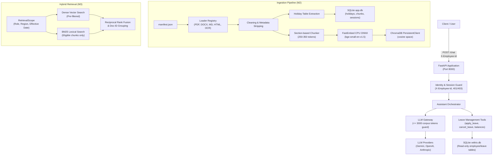

# Veltrix PeopleOps Assistant

Production-grade HR Q&A and Leave Management HTTP Service built with FastAPI, embedded ChromaDB, and FastEmbed.

---

## Architecture Overview



---

## Setup and Quickstart

### Prerequisites
- Python 3.12+
- `uv` package manager (`pip install uv` or via official installer)
- Tesseract OCR (installed and available in system PATH)

### 1. Installation
Clone the repository and install all dependencies:
```bash
uv sync
```

### 2. Environment Configuration
Create a `.env` file from the provided template:
```bash
cp .env.example .env
```
Ensure the data paths in `.env` point to your `./data` directory:
```env
CORPUS_DIR=./data/corpus
MANIFEST_PATH=./data/manifest.json
DB_PATH=./data/veltrix.db
APP_DB_PATH=./app.db
CHROMA_DIR=./chroma_db
APP_TODAY=2026-09-15
LLM_PROVIDER=gemini
```

### 3. Running with Docker Compose
The complete application with background ingestion and health checks can be started using Docker Compose:
```bash
docker compose up --build
```
The service will start listening on port 8000 immediately:
- `GET /health` returns HTTP 503 while ingestion is running in the background.
- `GET /health` returns HTTP 200 `{"status": "ok"}` once all documents and calendars are fully indexed.

### 4. Running Locally
To run the service locally:
```bash
uv run uvicorn veltrix.api.main:app --host 0.0.0.0 --port 8000
```

### 5. Running the Automated Test Suite
Run the test suite via `make` or `uv`:
```bash
make test
# Or directly:
uv run pytest
```
Run linting:
```bash
make lint
```

---

## Verified Ingestion Features (Milestone M2)
- **Universal Format Support**: Handled via `LoaderRegistry` for `.pdf`, `.docx`, `.md`, and `.html`.
- **Scanned Document OCR**: Seamless 300 DPI image rendering, Pillow contrast enhancement, and Tesseract OCR execution for scanned PDFs with no text layer.
- **Table Preservation**: Tables in DOCX, Markdown, and HTML are preserved in chronological context; large tables are segmented by row groups while repeating headers.
- **Holiday Extraction**: Automatic parsing of holiday tables from calendar documents into SQLite `holidays` table with flexible date normalization.
- **Idempotency**: Computes a SHA-256 hash over `manifest.json` and all corpus files. If the hash matches the previous run, re-indexing is skipped.

---

## Assumptions
See [`docs/ASSUMPTIONS.md`](docs/ASSUMPTIONS.md) for the running ledger of decisions, including:
- Manifest metadata is the sole authoritative source of document IDs, access levels, and regions.
- Public holidays are extracted automatically and used to determine working days for leave applications.
- In-document metadata headers/tables are stripped from chunk texts to avoid polluting vector search and LLM prompts.
